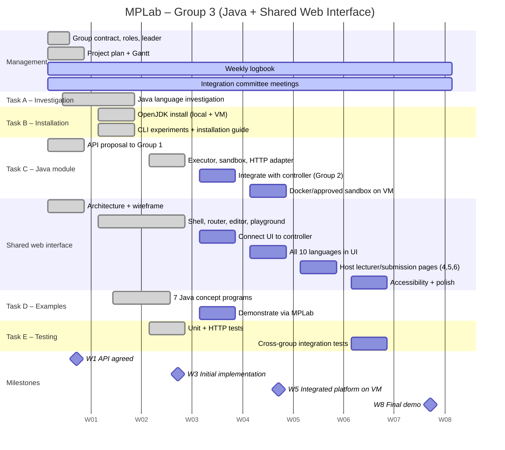

# Group 3 – Gantt Chart (8 weeks)

Prepared in Week 1 and updated weekly (Brief §5.3). Replace `2026-xx` dates with the real semester dates; the chart below assumes the project starts on a Monday, **Week 1 = day 0**.

> GitHub renders the Mermaid chart below. For the report, export it as an image (mermaid.live → PNG) or rebuild it in Excel using the table in §2.

## 2. Table version

| Task | Owner | W1 | W2 | W3 | W4 | W5 | W6 | W7 | W8 | Status |
|---|---|:-:|:-:|:-:|:-:|:-:|:-:|:-:|:-:|---|
| Group contract, roles, plan, Gantt | Leader | ■ | | | | | | | | Done |
| API proposal / architecture | M2, M4 | ■ | | | | | | | | Done |
| Task A – Java investigation | M6 | ■ | ■ | | | | | | | Done |
| Task B – Install OpenJDK + guide | M3 | | ■ | | | | | | | Done (local); VM pending access |
| Task C – Java module v0.3 | M2 | | | ■ | | | | | | Done |
| Shared UI v0.3 (editor, run, output) | M4, M5 | | ■ | ■ | | | | | | Done |
| Task D – 5+ concept examples | M6 | | ■ | ■ | ■ | | | | | Written; demo W4 |
| Integration with controller (G2) | M2, M4 | | | | ■ | ■ | | | | Planned |
| VM deployment + sandbox | M3 | | | | | ■ | | | | Planned |
| Lecturer/submission pages in shell | M4, M5 | | | | | | ■ | | | Planned |
| Task E – cross-group tests | M3 | | | ■ | ■ | ■ | ■ | ■ | | Unit/HTTP tests done |
| Error display with G8, a11y polish | M5 | | | | | | | ■ | | Planned |
| Technical report + presentation | All | | | | | | | ■ | ■ | Planned |
| Logbook | Leader | ■ | ■ | ■ | ■ | ■ | ■ | ■ | ■ | Ongoing |

Legend: M1–M6 = members as listed in the project plan.
