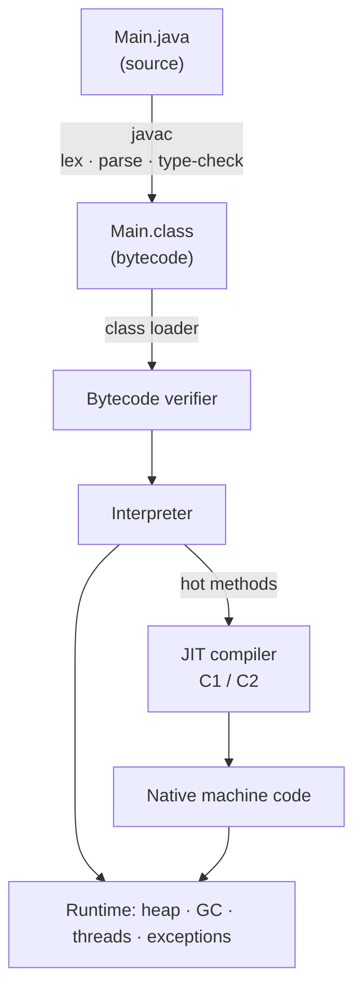

# Task A – Java Language Investigation

**Group 3 · MPLab · Week 2 deliverable**

## 1. Paradigm and main characteristics

Java (first released by Sun Microsystems in 1995, now stewarded by Oracle and the OpenJDK community) is a **general-purpose, class-based, object-oriented, imperative** language that has added **functional** features since Java 8 (lambdas, streams, method references), plus records, sealed types and pattern matching in recent releases.

| Characteristic | Description |
|---|---|
| Object-oriented | Almost all code lives in classes; supports encapsulation, inheritance (single class, multiple interfaces) and polymorphism |
| Statically, strongly typed | Every variable and expression has a compile-time type; implicit conversions are only allowed when widening (`int`→`long`) |
| Compiled to bytecode | `javac` compiles source to platform-independent **bytecode** (`.class`), which the **JVM** executes. "Write once, run anywhere" |
| Managed memory | Objects live on a garbage-collected heap; there is no pointer arithmetic and no manual `free` |
| Safe by design | Array bounds, null dereferences and casts are checked at run time and raise exceptions instead of corrupting memory |
| Concurrency built in | Threads, `synchronized`, `java.util.concurrent`, and virtual threads (Java 21) |
| Large standard library | Collections, I/O, networking, an HTTP server (used by our module), and more |

## 2. Compiler / interpreter implementation (OpenJDK)

Java uses a **hybrid** implementation: it is compiled **and** interpreted.

| Component | Role |
|---|---|
| `javac` | The front-end compiler, written in Java. Lexing → parsing → attribution (name resolution and **type checking**) → flow analysis → desugaring (generics erasure, lambdas, inner classes) → bytecode generation |
| `.class` file | Contains a constant pool, field/method tables and bytecode instructions for a stack-based virtual machine |
| HotSpot JVM | Loads classes, **verifies** bytecode, **interprets** it at first, then profiles hot methods and **JIT-compiles** them to native code using C1 (fast) and C2 (optimising) compilers (*tiered compilation*) |
| Garbage collector | G1 is the default; Serial is used in MPLab because it starts faster and uses little memory for small programs |
| Source launcher | `java Hello.java` compiles in memory and runs a single file (JEP 330). Convenient for experiments, but MPLab uses separate `javac` + `java` steps to tell compile errors from runtime errors |

## 3. Source-code execution process

1. **Compile:** `javac Main.java` produces `Main.class`. Syntax and type errors stop here and nothing runs (MPLab status `compile_error`).
2. **Load:** `java -cp . Main` starts the JVM, which loads `Main` and the classes it needs, lazily.
3. **Verify:** the verifier checks that the bytecode is type-safe (e.g. no int used as a reference).
4. **Link and initialise:** static fields are initialised and `static {}` blocks run.
5. **Execute:** `public static void main(String[] args)` is invoked. Bytecode is interpreted and hot code is JIT-compiled.
6. **Terminate:** exit code `0` on normal return, `1` on an uncaught exception, or the value passed to `System.exit(n)` (MPLab: `success` / `runtime_error`).

Our own `javap -c Hello` output (Week 2 experiment log) shows the bytecode `getstatic`, `ldc`, `invokevirtual` for `System.out.println("Hello, MPLab!")`, which shows that the JVM is a **stack machine**.

## 4. Data types, variable binding and scope

**Types**

| Category | Types | Notes |
|---|---|---|
| Primitive (8) | `byte` 8-bit, `short` 16, `int` 32, `long` 64, `float` 32, `double` 64, `char` 16-bit unsigned UTF-16 unit, `boolean` | Sizes fixed by the language spec, not by the CPU. Integer overflow wraps silently |
| Reference | classes, interfaces, arrays, enums, records | Variables hold references; `null` is allowed. `String` is an immutable class |
| Generics | `List<String>` | Checked at compile time, **erased** at run time |
| Wrappers | `Integer`, `Double`… | Autoboxing converts between primitives and objects |

**Binding**

| What | Binding time |
|---|---|
| Keyword meaning, primitive sizes | Language design time |
| Variable types, overload resolution, `static final` constants | **Compile time** (static/early binding) |
| Class loading, static field storage | Load time |
| Instance method overrides (virtual dispatch), object storage | **Run time** (dynamic/late binding) |
| Local variable storage | On each method call (stack frame) |

**Scope** is **lexical (static)** and block-structured: a local variable is visible from its declaration to the end of its enclosing `{}` block. Fields are visible throughout the class, subject to access modifiers (`private`, package-private, `protected`, `public`). A local variable may **shadow** a field (`this.x` reaches the field), but cannot redeclare another local in an enclosing block. Lambdas and inner classes may capture only **effectively final** locals.

**Lifetime:** locals live in stack frames, objects live on the heap until they become unreachable and are collected, and static fields live as long as their class.

## 5. Type checking and error handling

* **Static type checking** by `javac`: assignments, method arguments, return types, generics and checked exceptions. Example: `int n = "five";` gives *incompatible types: String cannot be converted to int*.
* **Dynamic checks** by the JVM: downcasts (`ClassCastException`), array bounds (`ArrayIndexOutOfBoundsException`), `null` (`NullPointerException`), array stores (`ArrayStoreException`), and integer division by zero (`ArithmeticException`).
* **Strong typing:** no implicit `int`→`boolean`, no pointer casts.
* **Type inference:** `var` (Java 10) and the diamond `<>` operator, both still statically typed.

**Exceptions:** `Throwable` → `Error` (e.g. `OutOfMemoryError`, `StackOverflowError`) and `Exception`.
*Checked* exceptions (subclasses of `Exception` but not `RuntimeException`, e.g. `IOException`) must be caught or declared with `throws`, and the **compiler enforces this**. *Unchecked* exceptions (`RuntimeException` subclasses) need no declaration. Handling uses `try / catch / finally` and `try-with-resources`. An uncaught exception prints a stack trace to **stderr** and the JVM exits with code **1**, which MPLab reports as `runtime_error` and uses to highlight the line in the editor.

## 6. Runtime requirements and dependencies

| Requirement | Value used by MPLab |
|---|---|
| JDK | OpenJDK **21 LTS** (module also works on 17+). Package `openjdk-21-jdk-headless` on Ubuntu |
| Commands | `javac` (compile), `java` (run), `javap` (inspect bytecode) |
| Memory | JVM baseline ~40–60 MB; per-program heap capped with `-Xmx256m` |
| Start-up time | ≈0.3 s compile + ≈0.1 s run for small programs on our test machine |
| OS | Any OS with a JDK; the VM uses Linux |
| External libraries | None. Programs may only use the Java standard library |
| Sandbox | Docker image `eclipse-temurin:21-jdk` (or the class-approved sandbox), with no network, read-only filesystem and capped CPU/memory/PIDs |

## 7. Implications for MPLab

1. **Class name = file name.** A `public class Calculator` must be in `Calculator.java`. Our `SourceAnalyzer` detects this, so students can paste any valid program.
2. **Two stages.** Compile errors and runtime errors are clearly separated, which matches the API's `stage` field.
3. **The JVM start-up cost** dominates for short programs. For Group 5's many test cases, we plan to compile once and run many times.
4. **Java has no built-in way to sandbox untrusted code** (the Security Manager was removed in recent JDKs), so isolation must come from the OS/container, as the brief requires.

## References

[1] J. Gosling *et al.*, *The Java Language Specification, Java SE 21 Edition*, Oracle, 2023. [Online]. Available: https://docs.oracle.com/javase/specs/jls/se21/html/
[2] T. Lindholm *et al.*, *The Java Virtual Machine Specification, Java SE 21 Edition*, Oracle, 2023. [Online]. Available: https://docs.oracle.com/javase/specs/jvms/se21/html/
[3] OpenJDK, "JEP 330: Launch Single-File Source-Code Programs." [Online]. Available: https://openjdk.org/jeps/330
[4] OpenJDK, "JEP 411: Deprecate the Security Manager for Removal." [Online]. Available: https://openjdk.org/jeps/411
[5] R. W. Sebesta, *Concepts of Programming Languages*, 12th ed. Pearson, 2019.
